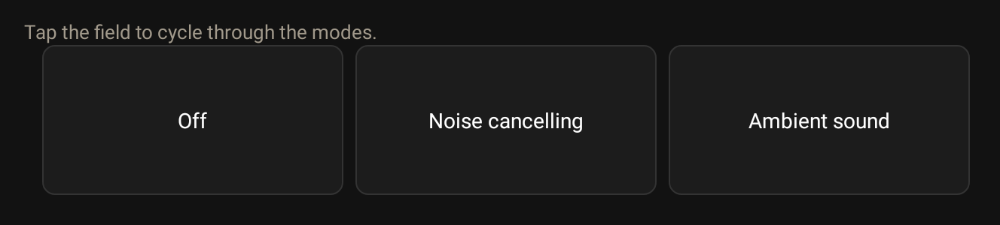

# 

[](https://github.com/nikosavola/karoo-xm-headphones/actions/workflows/ci.yml)
[](https://codecov.io/gh/nikosavola/karoo-xm-headphones)
[](https://sonarcloud.io/summary/new_code?id=nikosavola_karoo-xm-headphones)
[](LICENSE)

A [Hammerhead Karoo](https://www.hammerhead.io/) extension for Sony® headphones. It talks to the headset with Sony's own protocol and puts the controls from the Sound Connect app on the Karoo.

<p align="center">
  <a href="https://github.com/nikosavola/karoo-xm-headphones/releases/latest/download/app-release.apk">
    
  </a>
</p>

## Install

The APK is attached to every [release](https://github.com/nikosavola/karoo-xm-headphones/releases). On a Karoo 3, open the release page on your phone, long press the APK link and share it with the Hammerhead Companion app. On a Karoo 2, download it and run `adb install`. Then pair the headset in Karoo's Bluetooth settings, which is also where its audio goes.

The extension is not in Hammerhead's library yet.

## What it does

On a ride page you get the headset battery, the noise cancelling mode and the ambient level. Tap the noise cancelling field to cycle through off, noise cancelling and ambient sound. A controller action does the same from a button. An alert tells you when the headset drops.

The app screen has the same noise controls, the ambient level slider, focus on voice, the equalizer preset, and the model and firmware. Tap the headset name to see the protocol and capability details. The Forget button lets you pair a different headset next time.

## Screenshots

| Ambient | Scrolled | Details | Noise cancelling | Searching | No headset | Not supported | Permission |
| ------- | -------- | ------- | ---------------- | --------- | ---------- | ------------- | ---------- |
|  |  |  |  |  |  |  |  |



The images are drawn from the real screen and field code, with values a headset would report. The screen follows Karoo's day and night setting. Redraw the images with:

```sh
./gradlew :app:recordScreenshots
```

## Modules

| Module     | Type            | What it is                                                                                  |
| ---------- | --------------- | ------------------------------------------------------------------------------------------- |
| `protocol` | Pure Kotlin/JVM | The Sony frame codec and payload codecs. No Android types, so it runs on any JVM target.    |
| `client`   | Android library | The Bluetooth transport and the session over it. Exposes a `StateFlow` and suspend commands. |
| `app`      | Android app     | The Karoo extension: data types, the controller action, the alert and the control screen.    |

`protocol` and `client` are published, so another app, a Wear OS companion for example, can drive a Sony headset without reimplementing the protocol.

## Using the client

Every `v*` tag publishes both modules from CI, to GitHub Packages and to JitPack. JitPack builds the tag on its first request, so it needs no token.

```kotlin
repositories {
    maven {
        url = uri("https://maven.pkg.github.com/nikosavola/karoo-xm-headphones")
        credentials {
            // A classic PAT with read:packages. GitHub Packages rejects anonymous reads even of a
            // public package, and does not accept fine-grained tokens.
            username = System.getenv("GITHUB_ACTOR")
            password = System.getenv("GITHUB_TOKEN")
        }
    }
    maven("https://jitpack.io")  // no token
}

dependencies {
    // Either registry works; use one per module, not both.
    implementation("fi.nikosavola.xmheadphones:client:<version>")  // GitHub Packages
    // implementation("com.github.nikosavola.karoo-xm-headphones:client:<tag>")  // JitPack

    // Just the frame codec, for a JVM tool or something that brings its own transport.
    implementation("fi.nikosavola.xmheadphones:protocol:<version>")
}
```

```kotlin
val client = XmHeadphonesClient.get(context)
client.start()
client.state.collect { state -> /* link, battery, noise cancelling, ... */ }
client.setNoiseCancelling(NoiseCancelling.Ambient(level, focusOnVoice = false))
```

Commands return `false` when there is no link or the headset does not offer the feature. They do not throw.

The headset has to be paired first, because its control channel only exists for a paired device. Callers also need the permissions `XmHeadphonesClient.requiredPermissions()` returns, and each one has to be declared in their manifest.

## Build

```sh
./gradlew :app:assembleDebug    # the extension APK
./gradlew test                  # every module's tests
```

You need an Android SDK with platform 37 and `sdk.dir` in `local.properties`. Gradle runs on JDK 21, which is pinned in `gradle/gradle-daemon-jvm.properties`.

## Privacy

The extension talks to the headset and to nothing else. It declares no network permission, and nothing it reads leaves the device.

## Credits

The protocol was worked out from these projects. None of them is Sony's, and each is permissively licensed:

- [mos9527/SonyHeadphonesClient](https://github.com/mos9527/SonyHeadphonesClient): payload definitions, service UUIDs and the packet captures the tests replay
- [AmitRajput-Dev/SonyBridge](https://github.com/AmitRajput-Dev/SonyBridge)
- [VyomJain6904/sony-headphones-linux](https://github.com/VyomJain6904/sony-headphones-linux)

Testing uses [nikosavola/karoo-ext-testing](https://github.com/nikosavola/karoo-ext-testing), which supplies the fake Karoo system.

## Licence

Apache-2.0.

## Trademarks

Sony and the WH-1000X and WF-1000X model names are trademarks or registered trademarks of Sony Group Corporation. Karoo and Hammerhead are trademarks of Hammerhead. This project is not affiliated with, endorsed by or sponsored by either company. All other trademarks belong to their respective owners.
