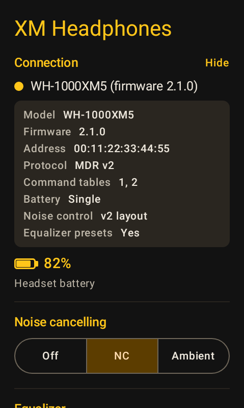
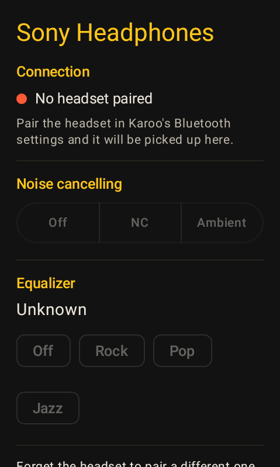

<p align="center"></p>

[](https://github.com/nikosavola/karoo-xm-headphones/actions/workflows/ci.yml)

A [Hammerhead Karoo](https://www.hammerhead.io/) extension for Sony® headphones. It talks to the
headset with Sony's own protocol and puts the controls from the Sound Connect app onto the Karoo.

It works against a real headset: a WF-1000XM5 on a Karoo, over the headset's classic Bluetooth
channel. What has and has not been checked is
[below](#what-has-and-has-not-been-checked-against-real-hardware).

## Installing

The APK is attached to every [release](https://github.com/nikosavola/karoo-xm-headphones/releases).
On a Karoo 3, open the release page on your phone, long-press the APK link and share it with the
Hammerhead Companion app. On a Karoo 2, download it and install it with `adb install`. Then pair the
headset in Karoo's Bluetooth settings, which is also where its audio goes.

It is not in Hammerhead's extension library yet.


## What it does

On a ride page:

- **Headset battery** as a number.
- **Noise cancelling** as text: off, cancelling, ambient, or ambient with voice. The mode has no
  number, so it needs a custom field.
- **Ambient level** as a number.
- A **controller action** that toggles noise cancelling. Assign it to a button.
- An alert when the headset drops.

On the app screen: the three noise control modes, the ambient level, focus on voice, the equalizer
preset, the model and firmware, and forgetting the headset so a different one can be paired. Tapping
the connected headset's name opens what the client knows about it. Most of it the handshake reported:
the protocol version, which command tables it answers on, and which battery, noise control and
equalizer layouts it advertised. The address is the paired device's rather than anything the headset
said. That is the first thing to look at when a control does nothing, since the same command byte
means different things on different models.

The same row says which wait the link is on: nothing paired, which is a step in Karoo's own Bluetooth
settings rather than anything this app can do, or a paired headset that has not answered yet. Under
it goes what went wrong. Two failures are named rather than quoted: headphones that are not
connected, and a paired device that is on but does not speak Sony's protocol. Anything else, a
refused connection or a command table switched off, appears in the headset's or the platform's own
words.

## Screenshots

| Ambient sound | The same screen, scrolled | What the headset reported | Noise cancelling | Waiting for the headset | No headset paired | No noise control | Waiting for permission |
| ------------- | ------------------------- | ------------------------- | ---------------- | ----------------------- | ----------------- | ---------------- | ---------------------- |
|  |  |  |  |  |  |  |  |

These are the real composables at 480x800, with values a headset would report, not drawings of the
screen. Each state is set directly rather than reached by driving a headset, which is what makes an
image of a state reproducible. The dark palette is Sound Connect's, a near black screen with an amber
accent, so a rider who set their headset up in Sony's app recognises the controls. The screen follows
Karoo's own day/night setting, so in daylight the same accent is drawn on a warm light ground.

- Every test checks the screen before capturing it: the texts, and, in the states that have them, that
  the slider and the switch exist, which chip is selected, and that no chip wrapped its label. The
  first version checked only the texts and published a screen whose chips had been crushed to one
  letter per line, which no text assertion can see.
- They are drawn at 280 dpi. The Karoo in hand reports 480x800 at 300 dpi, so its viewport is a little
  narrower than an image shows.
- The screen is taller than the 457dp drawn, so it scrolls. The second image is that state scrolled
  down.
- The ride page fields are not pictured, since Karoo draws those from the text and numbers the
  extension streams.
- The tests write to `app/build/screenshots`, never over the committed copies, so a test run leaves the
  tree clean. Redrawing the images above is a deliberate step:

```sh
./gradlew :app:recordScreenshots
```

## Modules

| Module     | Type             | What it is                                                                                     |
| ---------- | ---------------- | ---------------------------------------------------------------------------------------------- |
| `protocol` | Pure Kotlin/JVM  | The Sony frame codec, the command/payload definitions and the frame assembler a reader needs. No Android types, so it can back any client. |
| `client`   | Android library  | The classic Bluetooth transport and the session over it, exposed as a `StateFlow` of headset state plus suspend commands. |
| `app`      | Android app      | The Karoo extension: data types, the controller action, the alert and the control screen.        |

`protocol` and `client` are published, so another app, a Wear OS companion for instance, can drive a
Sony headset without reimplementing the protocol.

## Using the client

```kotlin
dependencies {
    // JitPack builds the tags, so this needs no token.
    implementation("com.github.nikosavola.karoo-xm-headphones:client:<tag>")
    // Or GitHub Packages, which does:
    implementation("fi.nikosavola.xmheadphones:client:<version>")
}
```

Both libraries are published. `protocol` carries no Android types, so a non-Android client can take
just that one.

```kotlin
val client = XmHeadphonesClient.get(context)
client.start() // begins looking for a headset
client.state.collect { state -> /* link, battery, noise cancelling, ... */ }
client.setNoiseCancelling(NoiseCancelling.Ambient(level, focusOnVoice = false))
```

Every command returns false rather than throwing when there is no link, or when the headset never
advertised the feature. A caller that is merely early needs no exception handling.

The headset has to be paired before any of this, since its control channel is a classic one that only
exists for a paired device. Pairing is the rider's own step in Karoo's Bluetooth settings, which is
how their audio gets there too.

A caller has to hold the right permissions before the client can reach a paired headset, and they
differ by platform. `XmHeadphonesClient.requiredPermissions()` returns the set to ask for, and each
name also has to be declared in the caller's manifest. Android 12 put reading the paired devices
behind `BLUETOOTH_CONNECT`, which is all the list holds from there on. Below it the platform's own
install-time `BLUETOOTH` and `BLUETOOTH_ADMIN` cover it, granted at install, so the list is empty. A
request for a permission that is not declared is ignored without an error, which leaves a screen
asking for something nothing can grant.

## Building

```sh
./gradlew :app:assembleDebug    # the extension APK
./gradlew test                  # every module's tests
```

Needs an Android SDK with platform 37, with `sdk.dir` in `local.properties`. Gradle runs on JDK 21,
pinned in `gradle/gradle-daemon-jvm.properties` and provisioned by the foojay resolver. On JDK 27 one
of AGP's tasks fails to initialise, which breaks the library publication while the app still builds.

## What has and has not been checked against real hardware

Against a WF-1000XM5 on a Karoo, over the headset's classic Bluetooth channel. Android 12 (API 32),
480x800 at 300 dpi, product `k24`.

**The transport used to be wrong, and that is fixed.** The client looked for Sony's Tandem-over-BLE
service, `5b833e20-6bc7-4802-8e9a-723ceca4bd8f`. This headset does not have it: an unfiltered BLE
scan finds it advertising as `LE_WF-1000XM5` on a random LE address, and its GATT table has thirteen
services of which the Sony ones are `5b833e06` and `5b833e26` (Bluetooth connection and pairing),
plus `5b833e27` and `dc405470-...`. There is no `5b833e20` and no `5b833c60`/`5b833c61` pair, so no
scan filter ever matched and the client sat in Searching.

The headset runs the protocol over a **classic serial channel it registers with SDP** instead, which
is where every reference implementation talks to these headsets. The client now opens that channel,
trying Sony's MDR v2 service `956c7b26-d49a-4ba8-b03f-b17d393cb6e2` first and the MDR v1 service
`96cc203e-5068-46ad-b32d-e316f5e069ba` after it, and it reaches the headset unaided.

What that run confirms:

- the link comes up, the handshake completes and the app reports the model and firmware the headset
  sends: `WF-1000XM5 (firmware 6.1.0)`;
- **the write direction works.** Picking a mode on the Karoo moves the headset: choosing ambient put
  it in ambient sound, and after a full restart, with nothing left in the app to echo back, the mode
  read from the headset was still ambient sound at the level that was set. The earlier note that no
  capture existed of a headset being told to change mode is answered;
- the protocol is V2 with both command tables enabled, and every frame this client sends is
  acknowledged by the headset;
- the battery reads. A real handshake and a real battery question, captured over the channel:
  `3e 0c 00 00 00 00 02 00 00 0e 3c` answered by `3e 0c 01 00 00 00 08 01 00 03 00 30 18 00 00 61 3c`
  (V2, both tables on), then `3e 0c 00 00 00 00 02 22 00 30 3c` answered by
  `3e 0c 01 00 00 00 04 23 00 64 00 98 3c`, which is 100 percent and not charging.

**One bug came out of it.** The battery was gated on function ids `0x20` and `0x21`, which are the
numbers a device reports on its second command table. This headset reports `0x11` and `0x15` on the
first one, as a WH-1000XM3 does, so the client believed no battery was offered at all and the screen
showed none. Both ids are now one list, shared by both protocol versions, because they belong to the
command table rather than to the version.

Against hardware, using the packet captures committed to
[mos9527/SonyHeadphonesClient](https://github.com/mos9527/SonyHeadphonesClient):

- the frame layer (markers, escaping, checksum, length) round-trips every packet of a WH-1000XM3
  session byte for byte;
- the V1 handshake replies and the V1 noise control and battery reports decode to the states that
  headset was in.

The code fails closed where it matters. A headset that never answers is given up on rather than
waited on forever. A frame this client cannot read is logged and acknowledged anyway, because a
headset left unacknowledged keeps resending it, and that resend loop was watched on this device.

Not checked:

- **Every other model.** Only an XM5-generation earbud has been used. The V2 layouts for the
  WH-1000XM5, the WF-1000XM4, the WH-CH720N and the rest come from the same generated headers; no
  device has confirmed them.
- **Where the two generations disagree.** The headers spell these out and the tests pin them. The
  equalizer sits in slot `0x01` on V1 and `0x00` on V2, where V1's slot is V2's Clear Bass. V1 marks
  its noise cancelling slot separately, while V2 carries the ambient level through an off. A V2 device
  reports each function as a code and a priority, not a flat run of codes.
- **The v1 service.** The fallback to `96cc203e-...` is what the reference implementations do for the
  XM4 generation and older, but no such headset has been in hand, so only the v2 path has been seen
  working. Its ordering is pinned by a test and nothing more.
- **Earbuds' per-bud detail.** The left/right and cradle battery questions were each answered by this
  headset, but the app asks the single one and shows one number, so what a pair reports per bud has
  not been seen on a screen.
- **Custom equalizer curves.** The headset answers the equalizer parameter with the curve itself: six
  band values and a Clear Bass value after the preset byte. This client reads the preset byte and
  discards the rest, so it shows which curve is on without being able to change it. Driving those
  bands needs a codec for them and a control to edit six of them on a 256dp screen, and the band count
  is not assumed to be six on every model.
- **Which transports each model offers.** This one exposes no Tandem-over-BLE service. Whether any
  model does, and which service UUID an XM3 or an XM4 sits behind, is unconfirmed.

## Credits

The protocol was worked out from the projects below. None of them is Sony's, and each is permissively
licensed:

- [mos9527/SonyHeadphonesClient](https://github.com/mos9527/SonyHeadphonesClient): the payload
  definitions, the service UUIDs and the packet captures the tests replay
- [AmitRajput-Dev/SonyBridge](https://github.com/AmitRajput-Dev/SonyBridge)
- [VyomJain6904/sony-headphones-linux](https://github.com/VyomJain6904/sony-headphones-linux)

Testing uses [nikosavola/karoo-ext-testing](https://github.com/nikosavola/karoo-ext-testing), which
supplies the fake Karoo system and the harness the extension is driven through.

## Privacy

The extension talks to the headset and to nothing else. It declares no network permission, and
nothing it reads leaves the device.

## Licence

Apache-2.0.

## Trademarks

Sony and the WH-1000X and WF-1000X model names are trademarks or registered trademarks of Sony Group
Corporation, and all rights in them belong to Sony. Karoo and Hammerhead are trademarks of
Hammerhead. This project is not affiliated with, endorsed by, or sponsored by either company. All
other trademarks are the property of their respective owners.
