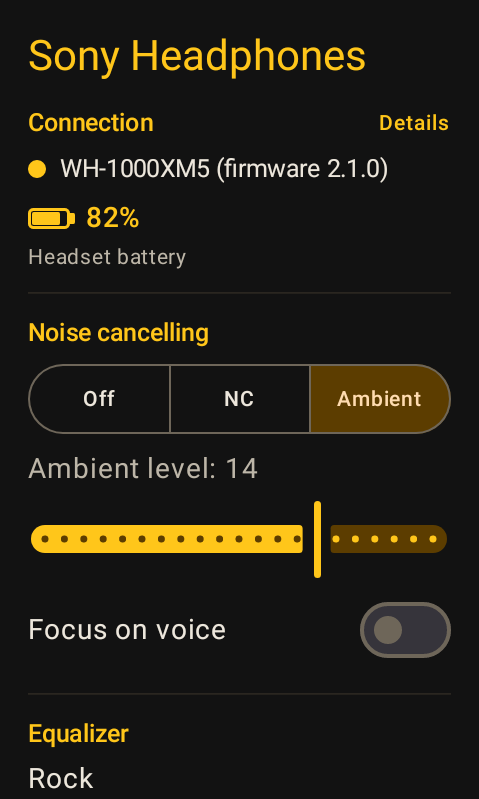
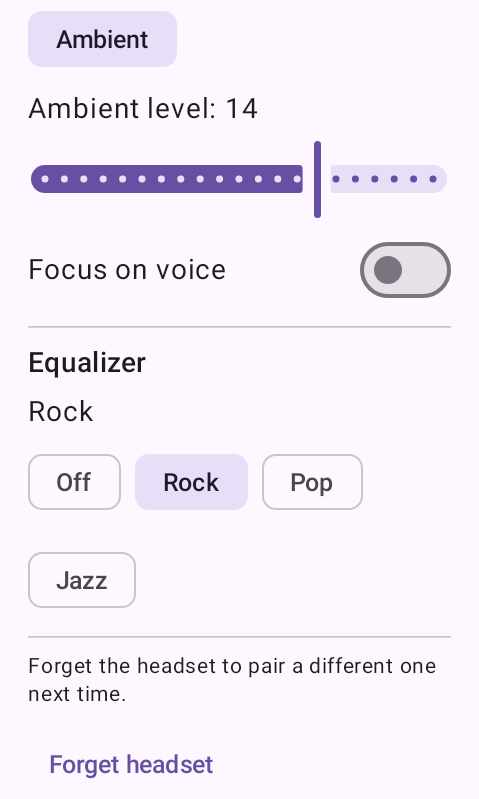
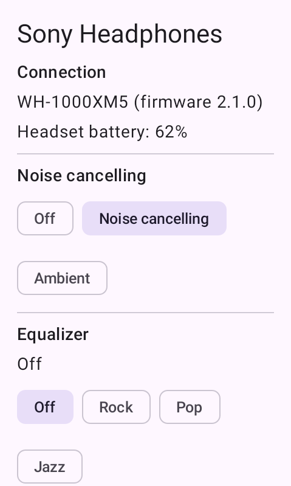
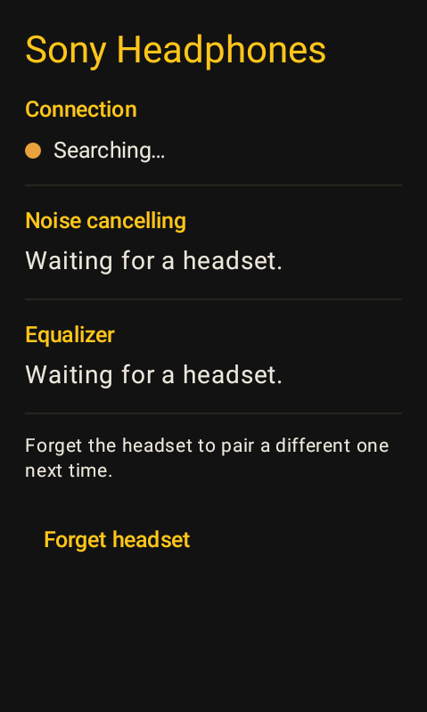
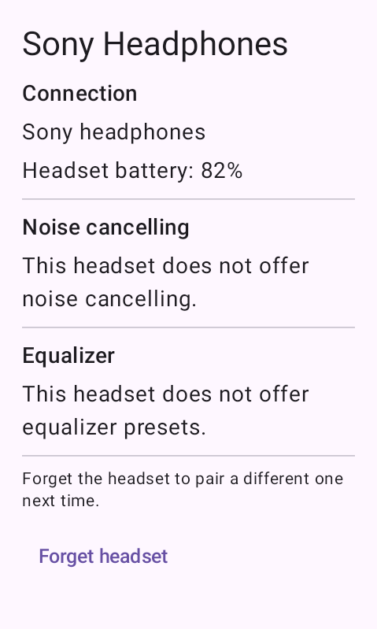
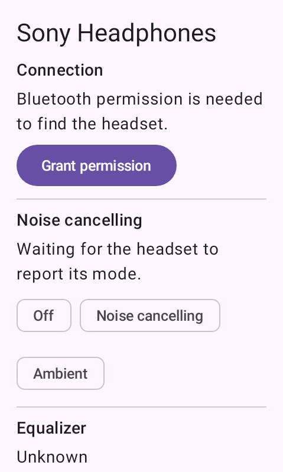

# XM Headphones

A [Hammerhead Karoo](https://www.hammerhead.io/) extension for Sony headphones. It talks to the
headset over BLE with Sony's own protocol and puts the controls you would otherwise reach for the
Sound Connect app onto the Karoo, plus a few data fields for the ride.

## What it does

On a ride page:

- **Headset battery** as a number.
- **Noise cancelling** as text (off, cancelling, ambient, ambient with voice) — a custom field, since
  the mode has no number to show.
- **Ambient level** as a number.
- A **controller action** that toggles noise cancelling, assignable to a button.
- An in-ride alert when the headset drops.

In the app screen: the three noise control modes, the ambient level, focus-on-voice, the equalizer
preset, the headset's model and firmware, and forgetting the headset so a different one is picked up.

## Screenshots

| Ambient sound | The same screen, scrolled | Noise cancelling | Searching | No noise control | Waiting for permission |
| ------------- | ------------------------- | ---------------- | --------- | ---------------- | ---------------------- |
|  |  |  |  |  |  |

These are the real composables, drawn at the Karoo 3's 480x800 with values such a headset would
report, not drawings of the screen. The states are set directly because no headset was available to
reach them.

Each test checks the screen before it captures it: the texts it has to show, and, in the states
that have them, that the level slider and the focus switch are there at all, which mode chip reads
as selected, and that no chip has been squeezed narrow enough to wrap its label. The first version
of this file asserted only that the texts were present, and published a screen whose chips had been
crushed to one letter per line.

The screen's content is about 695dp against the Karoo 3's 457dp of viewport, so it scrolls; the
second image is that same state scrolled to the bottom. The ride-page fields are not pictured:
Karoo draws those itself from the text and numbers the extension streams, and every image here is
of the settings screen.

The tests draw these into `app/build/screenshots`, never over the committed copies, so a test run
leaves the tree clean whatever the machine rasterizes like. Redrawing the images above is a
deliberate step:

```sh
./gradlew :app:recordScreenshots
```

## Modules

| Module     | Type             | What it is                                                                                     |
| ---------- | ---------------- | ---------------------------------------------------------------------------------------------- |
| `protocol` | Pure Kotlin/JVM  | The Sony frame codec and the command/payload definitions. No Android types, so it can back any client. |
| `client`   | Android library  | The BLE transport and GATT session, exposed as a `StateFlow` of headset state plus suspend commands. |
| `app`      | Android app      | The Karoo extension: data types, the controller action, the alert and the control screen.        |

`protocol` and `client` are published so a third-party app (a Wear OS companion, say) can drive a Sony
headset without reimplementing the protocol.

## Using the client

```kotlin
dependencies {
    // JitPack builds the tags, so this needs no token.
    implementation("com.github.nikosavola.karoo-xm-headphones:client:<tag>")
    // Or GitHub Packages, which does:
    // implementation("fi.nikosavola.xmheadphones:client:<version>")
}
```

Both libraries are published; `protocol` carries no Android types, so a non-Android client can take
just that one.

```kotlin
val client = XmHeadphonesClient.get(context)
client.start() // begins looking for a headset
client.state.collect { state -> /* link, battery, noise cancelling, ... */ }
client.setNoiseCancelling(NoiseCancelling.Ambient(level, focusOnVoice = false))
```

Every command returns false rather than throwing when there is no link, or when the headset never
advertised the feature, so a caller that is merely early does not have to handle an exception.

A caller has to hold the right permissions before anything is scanned, and they differ by platform:
`XmHeadphonesClient.requiredPermissions()` returns the set to ask for on the device, and each name
has to be declared in the caller's own manifest. Below Android 12 that also means the install-time
`BLUETOOTH` and `BLUETOOTH_ADMIN`, which are granted at install and so are not in the list. A request
for a permission that is not declared is ignored without an error, which is a screen saying a
permission is needed with nothing that can grant it.

## Building

```sh
./gradlew :app:assembleDebug    # the extension APK
./gradlew test                  # every module's tests
```

Needs an Android SDK with platform 37, with `sdk.dir` in `local.properties`. Gradle runs on JDK 21,
which `gradle/gradle-daemon-jvm.properties` pins and the foojay resolver provisions; a JDK 27 daemon
fails to initialise one of AGP's tasks, so `:client:bundleReleaseAar` and anything that depends on it
(the publication) breaks without that pin.

## What has and has not been checked against real hardware

**Nothing here has been run against a real headset.** No device was available while it was written,
which shapes what follows.

Checked against hardware, via the packet captures committed to
[mos9527/SonyHeadphonesClient](https://github.com/mos9527/SonyHeadphonesClient):

- the frame layer — markers, escaping, checksum, length — round-trips every packet of a WH-1000XM3
  session byte for byte;
- the V1 handshake replies and the V1 noise-control and battery reports decode to the states that
  headset was actually in.

The APK has been installed and launched on an API 31 emulator configured as a Karoo 3, 480x800 at
280 dpi, which is the size the screenshots above use. It starts, asks for the Bluetooth permission it
needs, reads the adapter state, and with the adapter up it scans and settles on Searching. No headset
has been near it, and an emulator is not a Karoo: that run says the app installs and runs, nothing
about the protocol.

Not checked:

- **Everything in the write direction.** The set frames are built from the payload definitions in
  that project, field for field, but no capture of a headset being told to change mode was available.
- **The V2 layouts** (WH-1000XM5, WF-1000XM4/XM5, WH-CH720N and the rest). They come from the same
  generated headers, which were read out of the Sound Connect app.
- **The places the two generations disagree**, which the generated headers do spell out and the tests
  pin, but no device has confirmed: the equalizer lives in slot `0x01` on V1 and `0x00` on V2, where
  V1's slot is V2's Clear Bass; V1 marks its noise cancelling slot separately while V2 carries the
  ambient level through an off; a V2 device's advertised functions come back as a code and a
  priority per function rather than a flat run of codes.
- **Earbuds**, which report a level per bud and sometimes without a charging byte at all. Both forms
  are parsed and the lower bud is what a ride screen shows, but no pair of earbuds has been tried.
- **Whether V1 headsets answer on BLE at all.** On a desktop they are driven over the classic serial
  profile, which is the only transport any reference implementation demonstrates for them. This
  client looks for Sony's BLE control service, so if an XM3 or XM4 connects but never gets a
  handshake, that is the first thing to look at.
- **Whether every model advertises the same GATT table.** The UUIDs are SongPal's own, recorded by an
  independent project, and a headset that answers on them is what this client assumes. Only the one
  service it speaks is tried.

The code fails closed at every point where this matters: a headset that does not answer is reported as
such rather than guessed at, and a reply that does not fit its shape is logged in debug builds (which
plant a Timber tree) and acknowledged rather than acted on.

## Credits

The protocol was worked out from these projects, none of which is Sony's, and each of which is
permissively licensed:

- [mos9527/SonyHeadphonesClient](https://github.com/mos9527/SonyHeadphonesClient) — the payload
  definitions, the GATT table and the packet captures the tests replay
- [AmitRajput-Dev/SonyBridge](https://github.com/AmitRajput-Dev/SonyBridge)
- [VyomJain6904/sony-headphones-linux](https://github.com/VyomJain6904/sony-headphones-linux)

Testing uses [nikosavola/karoo-ext-testing](https://github.com/nikosavola/karoo-ext-testing), which
supplies the fake Karoo system and the simulated BLE stack.

## Licence

Apache-2.0.
